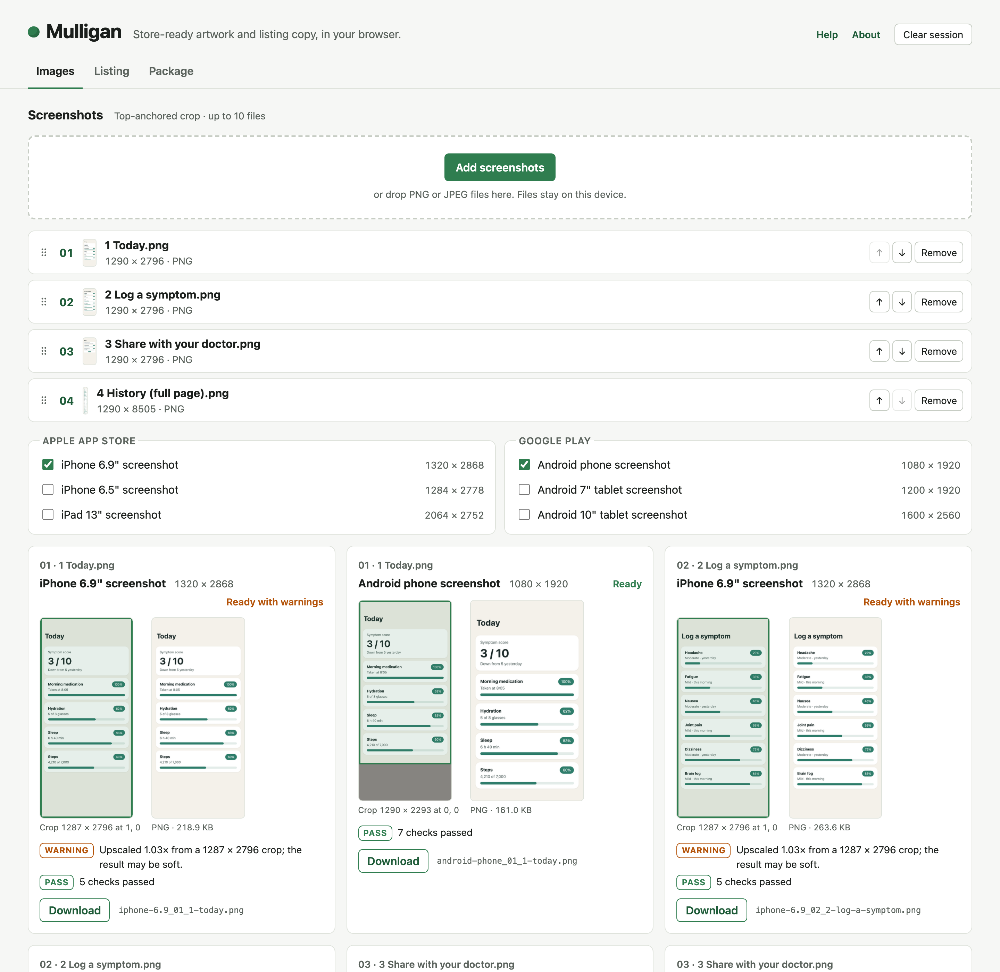
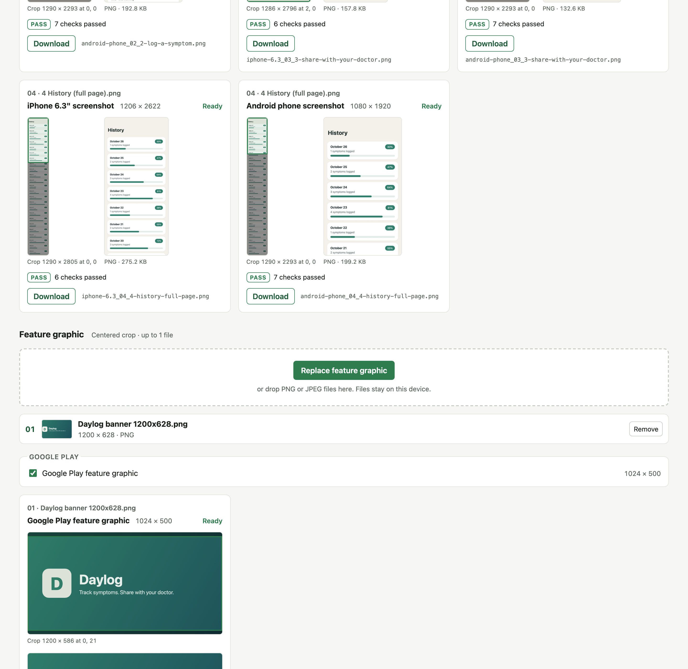
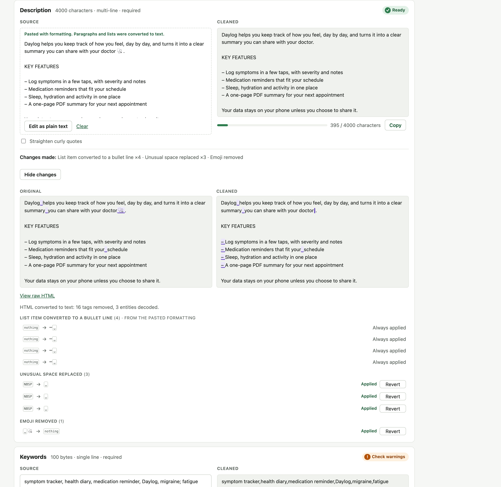
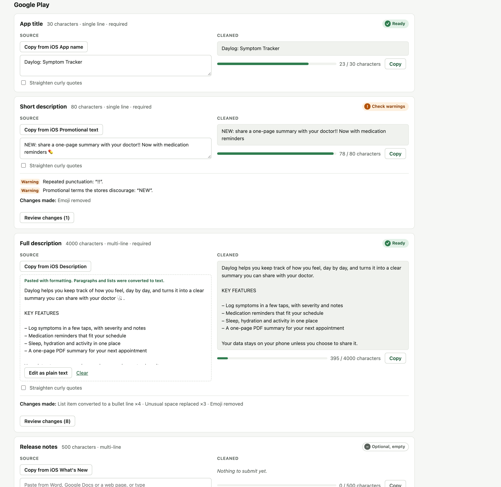
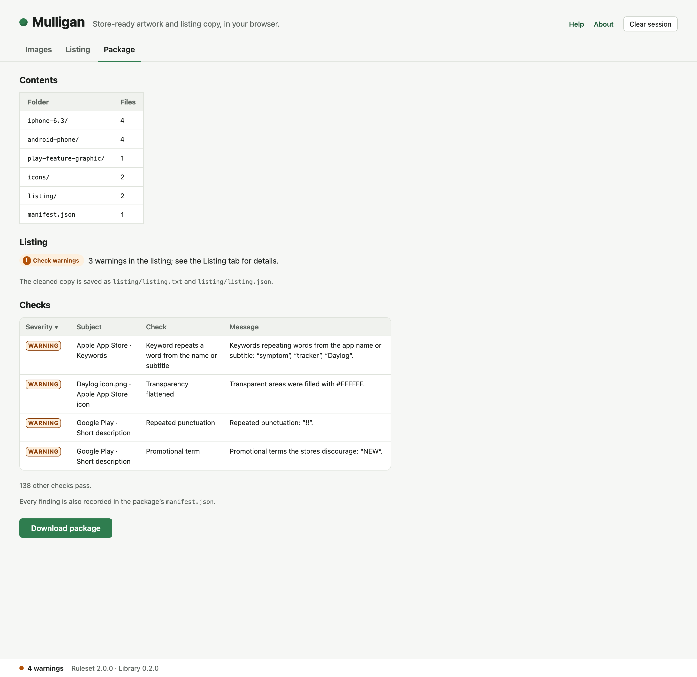
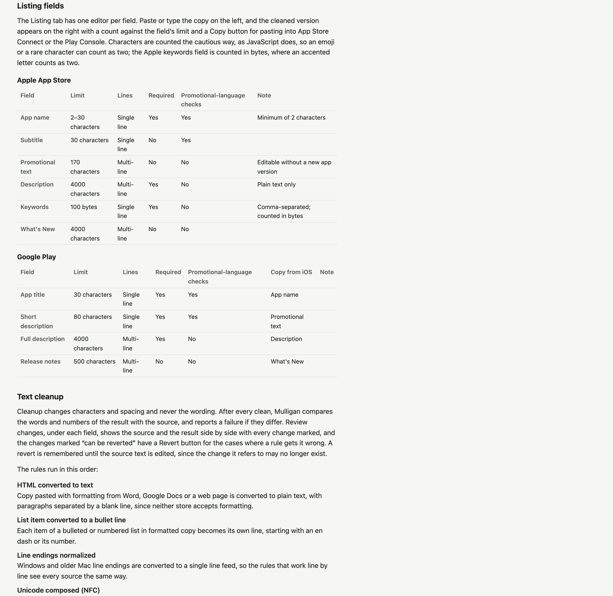

# Mulligan

[](https://github.com/thowland/mulligan/actions/workflows/ci.yml) [](LICENSE)

Mulligan prepares the artwork and listing copy an agency delivers for the Apple App Store and Google Play. Agency material rarely arrives in the shape the stores accept: screenshots are captured on whatever phone was at hand, so they are a few pixels off every store size; a feature graphic comes in at a social-media size; an icon has transparent corners the App Store will reject; and the listing copy is pasted out of Word with non-breaking spaces, emoji and hard line breaks that count against the field limits or trip the store's review. Each of those problems is mechanical, and each normally costs a round trip to the agency. Mulligan fixes them in the browser and records every change it makes, so the person uploading the listing can see exactly what was done and why.

The name comes from golf, where a mulligan is a second attempt at a shot that went wrong, taken without penalty.

Mulligan runs at https://mulligan.beta-site.us. It runs entirely in the browser, and the site's security policy forbids the page from making network requests at all, so the files and copy you work on never leave your device. There are no accounts, and nothing to install.

## Images

Each group of assets (screenshots, the Play feature graphic, the app icon) has its own drop zone, and a file only receives the presets of the group it was dropped into. Tick the store sizes you need; Mulligan crops each image to the preset's shape and then resizes it to the exact dimensions, and each preview card shows the crop drawn on the source, the result, and any warnings, such as a slight enlargement that may soften the image.



Screenshots are cropped from the top, because a full-page capture of a scrolling screen has its important content at the top, and the feature graphic and icon are cropped from the center. Transparency is filled with white wherever a preset does not allow it.



## Listing copy

Paste each field from Word, Google Docs or a web page. Mulligan converts formatting to plain text, replaces unusual spaces and invisible characters, removes emoji, normalizes bullets and line breaks, and counts the result against the field's limit, but it never changes the wording: after every clean it compares the words and numbers of the result with the source, and fails the field if they differ. Review changes shows the source and the result side by side with every change marked, and the changes a rule can get wrong, such as a heading joined to the paragraph below it, can be reverted one at a time.



Agencies usually deliver one version of the copy, written for the App Store. The Google Play fields that have an App Store counterpart carry a Copy from iOS button, which copies the App Store copy across, where it is cleaned again and checked against Google Play's own limits and promotional-language rules.



Copy can also arrive as a CSV or JSON template, which the Listing tab offers to send to the agency and then imports.

## The package

The Package tab lists what the download will contain and every warning and failure across the workspace. Download package writes one ZIP file with a folder per store size, the cleaned listing as text and JSON, and a `manifest.json` that records the rules version, a fingerprint of every source and output, each crop and every finding, so a package can be traced back to what produced it. Failures do not block the download, but Mulligan lists them and asks first.



## Where work is kept

Mulligan saves the session as you go, in the browser's own storage on your device: the source images, the pasted copy, your preset choices and any reverted changes. Reloading the page or restarting the browser brings it back. A session untouched for 30 days is deleted the next time Mulligan opens, and Clear session in the header removes everything at once, which is worth doing on a shared computer. Private browsing windows cannot keep a session, and Mulligan says so and works from memory.

The Help page in the app explains each store size, field and rule, the package layout, where work is saved and how to clear it. Its tables are generated from the same rules file the app applies, so they are always current.



## Updating the rules for store changes

Apple and Google change their requirements with little notice: a new iPhone brings a new screenshot size, and a field limit or a promotional-language rule can change between one release and the next. Every rule Mulligan applies lives in one file, [`packages/core/src/standards/standards.json`](packages/core/src/standards/standards.json), and nothing in the app's code names a particular store size or field. A new preset or field therefore appears in the drop zones, the Listing tab, the Help page, the templates and the package without any change to the code. The file is validated when it loads, so a mistake such as a duplicate id, an unknown store or two presets writing to the same folder fails the tests with a message naming the problem, rather than producing a broken package.

The file is also versioned and locked. Every package records the `rulesetVersion` and a fingerprint of the file, so the version must change whenever the rules do; a test compares the file with `standards.lock.json` and fails if the content changed while the version did not.

### Adding a screen size

Add an entry to `presets`, next to the others for the same store. For example, Apple's 6.3-inch iPhone size:

```json
{
  "id": "iphone-6.3",
  "name": "iPhone 6.3\" screenshot",
  "store": "apple",
  "group": "screenshot",
  "width": 1206,
  "height": 2622,
  "format": "png",
  "alpha": false,
  "folder": "iphone-6.3",
  "count": { "min": 1, "max": 10 },
  "defaultSelected": false,
  "note": "Optional; iPhone 16 Pro"
}
```

| Property               | Meaning                                                                                                                                                                    |
| ---------------------- | -------------------------------------------------------------------------------------------------------------------------------------------------------------------------- |
| `id`                   | A unique lowercase id, with words separated by hyphens or dots. Saved sessions and the manifest refer to it, so do not rename an existing one.                             |
| `name`                 | The label shown next to the checkbox and in the Help page.                                                                                                                 |
| `store`, `group`       | Which store the size belongs to (`apple` or `google`), and which drop zone feeds it (`screenshot`, `feature-graphic` or `icon`).                                           |
| `width`, `height`      | The exact output size in pixels.                                                                                                                                           |
| `format`               | `png` or `jpeg`, with an optional `jpegQuality` between 0 and 1 for JPEG.                                                                                                  |
| `alpha`                | Whether the output may keep transparency. When `false`, transparent areas are filled with `flatten` (a `#RRGGBB` color, white by default). JPEG cannot carry transparency. |
| `anchor`               | Optional; overrides the group's crop anchor (`top` or `center`).                                                                                                           |
| `folder`, `fileSuffix` | The package folder, and an optional suffix added to the file name. Two presets may share a folder only if their suffixes differ, as the two icons do.                      |
| `maxBytes`             | Optional; the store's file size limit, checked after rendering.                                                                                                            |
| `count`                | The number of images the store accepts for this size, reported as a warning when the group falls outside it.                                                               |
| `defaultSelected`      | Whether the size is ticked when a session starts.                                                                                                                          |
| `note`                 | Optional; shown in the preset picker and the Help page.                                                                                                                    |

### Adding or changing a listing field

Fields live in `fields`, grouped by store in the order they appear in the Listing tab. To change a limit, edit its `limit`; to add a field, add an entry:

```json
{
  "id": "google.example-field",
  "store": "google",
  "label": "Example field",
  "limit": { "max": 80, "unit": "chars" },
  "multiline": false,
  "required": false,
  "kind": "text",
  "checks": ["discouraged"],
  "copyFrom": "apple.subtitle",
  "note": "Shown in the Help page"
}
```

| Property    | Meaning                                                                                                                                                                |
| ----------- | ---------------------------------------------------------------------------------------------------------------------------------------------------------------------- |
| `id`        | A unique id, conventionally the store followed by the field name. Templates and saved sessions refer to it.                                                            |
| `label`     | The field name as the store's console shows it.                                                                                                                        |
| `limit`     | `max`, an optional `min`, and the `unit`: `chars` for character limits or `bytes` for byte limits, as Apple applies to keywords.                                       |
| `multiline` | Whether the field keeps line breaks. Single-line fields have breaks replaced with spaces.                                                                              |
| `required`  | Whether an empty field is a failure.                                                                                                                                   |
| `kind`      | `text`, or `keywords` for a comma-separated keyword list with duplicate and overlap checks.                                                                            |
| `checks`    | `["discouraged"]` adds the promotional-language checks (capitals, repeated punctuation and discouraged terms), which the stores apply to names and short descriptions. |
| `related`   | For a keywords field, the fields whose words should not be repeated as keywords.                                                                                       |
| `copyFrom`  | Optional; a field in the other store whose copy this field can take with Copy from iOS.                                                                                |
| `options`   | `{ "straightQuotes": true }` ticks Straighten curly quotes for the field by default.                                                                                   |

The text rules shared by every field are under `rules` in the same file: the list of discouraged terms, the capitals check and its allow-list (the place for acronyms such as FDA), the repeated-punctuation pattern, the symbols kept when emoji are removed, and which changes can be reverted.

### Choosing the version number

`rulesetVersion` follows semantic versioning, judged by its effect on a listing that passed before the change:

- **Major**, when a listing that passed can now fail: a tighter limit, a new required field or a new failing check.
- **Minor**, for additions that cannot cause a failure: a new screen size, a new optional field, a looser limit or a new warning.
- **Patch**, for labels, notes and wording.

### Checking the change

```bash
pnpm --filter @mulligan/core standards:lock    # record the new version and fingerprint
pnpm --filter @mulligan/web templates          # after any field change: regenerate the agency templates
pnpm gate                                      # lint, every test, build and end-to-end tests
```

One test fails on purpose after an addition: `packages/core/test/standards.test.ts` lists the presets and counts the fields, so that a change to the inventory is always deliberate. Update its list to match. It is also worth updating the preset table in section 4.3 of the [technical specification](docs/Mulligan%20Technical%20Specification.md), and checking the result in the Help page with `pnpm build && pnpm preview`.

## Documents

- [Requirements](docs/Mulligan%20Requirements.md)
- [Technical specification](docs/Mulligan%20Technical%20Specification.md)
- [Implementation plan](docs/Mulligan%20Implementation%20Plan.md)
- [Changelog](CHANGELOG.md), [contributing](CONTRIBUTING.md), [security](SECURITY.md) and the [code of conduct](CODE_OF_CONDUCT.md)

## Structure

The work is split so that the rules can be reused outside the browser. `packages/core` holds the rules file and the library that applies it, with no dependency on the browser or Node, so a planned command-line tool can run the same checks in a CI pipeline; `packages/render-canvas` renders images in the browser; and `apps/web` is the React application, which reaches the library only through a thin bridge layer.

## Development

Development requires Node 22 or later and pnpm.

```bash
pnpm install
pnpm exec playwright install chromium firefox webkit
pnpm dev                       # development server
pnpm build && pnpm preview     # the production build, served with the production headers
pnpm gate                      # lint, unit and browser tests with coverage, build, end-to-end tests
pnpm readme:screenshots        # after pnpm build: regenerate the screenshots in docs/images
```

Every change merges through `pnpm gate`, which requires lint to pass, every test to pass in Chromium, Firefox and WebKit, and at least 80% test coverage across the whole codebase.

## License

Copyright © 2026 Tim Howland. Mulligan is free software, released under the [GNU General Public License](LICENSE), version 3 or later. Questions and problems are welcome at th@wdogsystems.com or as GitHub issues.
